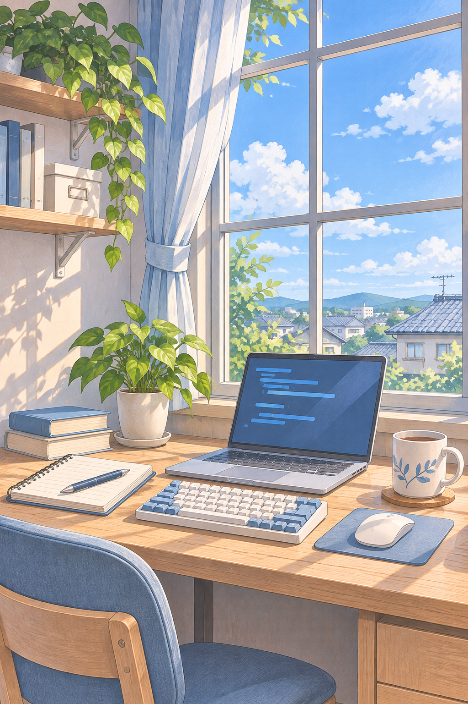

  
  <h2>Hi, I'm ForwardZuo.</h2>

  
写代码 · 做游戏 · 记录日常

  
喜欢把想法做成能用的小东西。 
  学习 Web 开发，也折腾 Linux 和自托管。 
  最近在做能和朋友一起玩的网页游戏。

   
  
  
  
  
  
  
  

  
Java / Python / JavaScript / Vue / Docker / Git / Linux

  
<a href="https://www.forwardzz.com/">博客 ↗</a>　·　<a href="https://games.forwardzz.com/">游戏站 ↗</a>

 

---

### 我的角落

**[随手记录 · 博客 ↗](https://www.forwardzz.com/)**  
开发记录、学习笔记，以及自托管的折腾过程。

**[一起玩 · 游戏站 ↗](https://games.forwardzz.com/)**  
在线小游戏，还有可以和朋友组队的多人房间。

### 正在折腾

- **网页游戏** — 让朋友打开浏览器就能一起玩。
- **开发环境** — 把项目和笔记整理得顺手一点。
- **自托管** — Linux、Docker 和自动化，边用边学。
